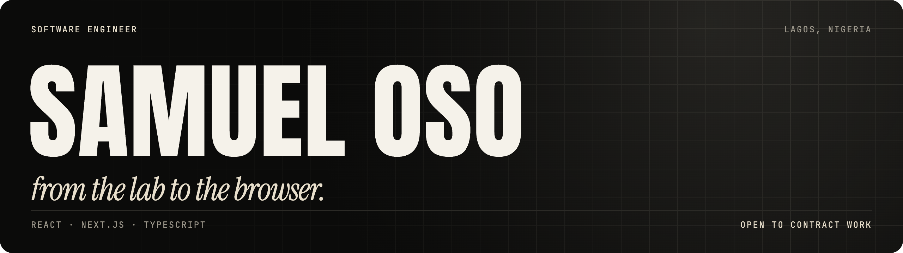
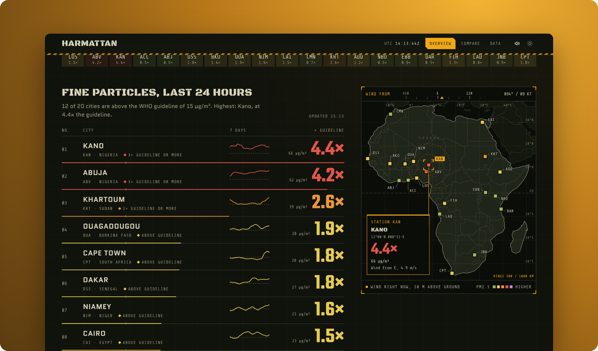
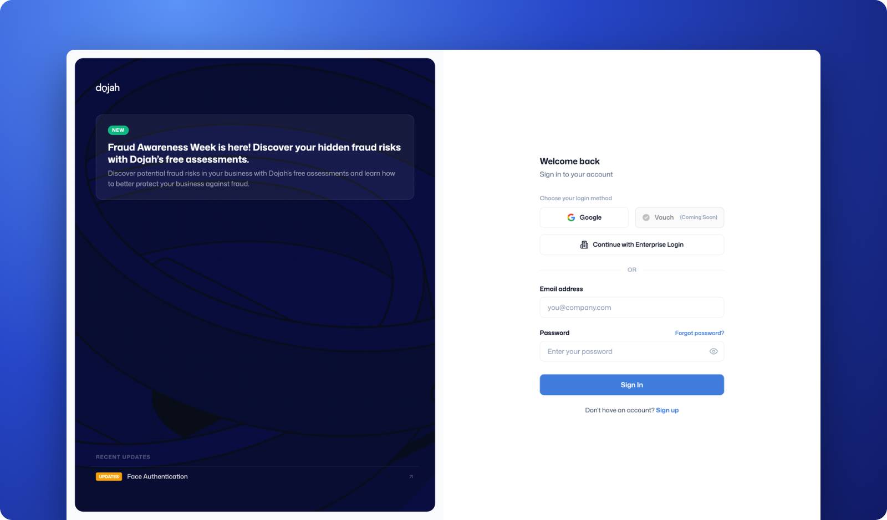

I'm a software engineer in Lagos, Nigeria, focused on the frontend. I take web products from first mockup to tested release, mostly with React, Next.js and TypeScript. I trained in biology and laboratory science before I wrote code, and I still work like a scientist: form a hypothesis, test it, trust the evidence.

Most of what I build sits in private company repositories, so this profile shows less than my working week does. Here is some of what's behind it.

## Work

**[Harmattan](https://github.com/samuel-oso/harmattan).** A dashboard for air quality across 20 African cities, hour by hour, named after the dusty wind that crosses West Africa each year. Every city is its own request, so one can fail and be retried without taking the others down. It charts seven pollutants over anything from a day to 90 days, compares up to four cities on one chart, and lists every hourly reading in a table you can sort, filter and download. Lint, types, unit tests, end-to-end tests and accessibility checks run on every push. The code is public, and it's [live here](https://harmattan-09s.vercel.app).

**[Dojah](https://samuel-oso-portfolio.vercel.app/work/dojah).** I'm a frontend engineer at Dojah, an identity verification company. In 2026 I built the new design for its dashboard, in light and dark. There was no switch-over day: the new screens went in beside the old ones while customers kept working, and colours that had been typed by hand were replaced with one set of named ones. I also build pages for the public website. The code is private, so the [case study](https://samuel-oso-portfolio.vercel.app/work/dojah) covers the decisions instead.

**Before that.** Since 2022 I've shipped production web apps at Elta Solutions, Sterling Bank and Zapflow, in full-time and contract roles.

## How I work

React, Next.js and TypeScript for products, with Jest and Playwright to keep them honest. I'm most useful on multi-step flows and dashboards, the screens where a lot of steps or a lot of data have to stay clear from the first screen to the last. I care about the parts people notice without naming them: fast loads, clear loading and error states, and flows that work for everyone. I mentor junior developers, review a lot of code, and use AI coding tools every day, checking and testing what they write before it ships.

## Elsewhere

Case studies at [samuel-oso-portfolio.vercel.app](https://samuel-oso-portfolio.vercel.app) · [LinkedIn](https://www.linkedin.com/in/samuel-oso/) · [ososamuel035@gmail.com](mailto:ososamuel035@gmail.com)

Open to contract work.
